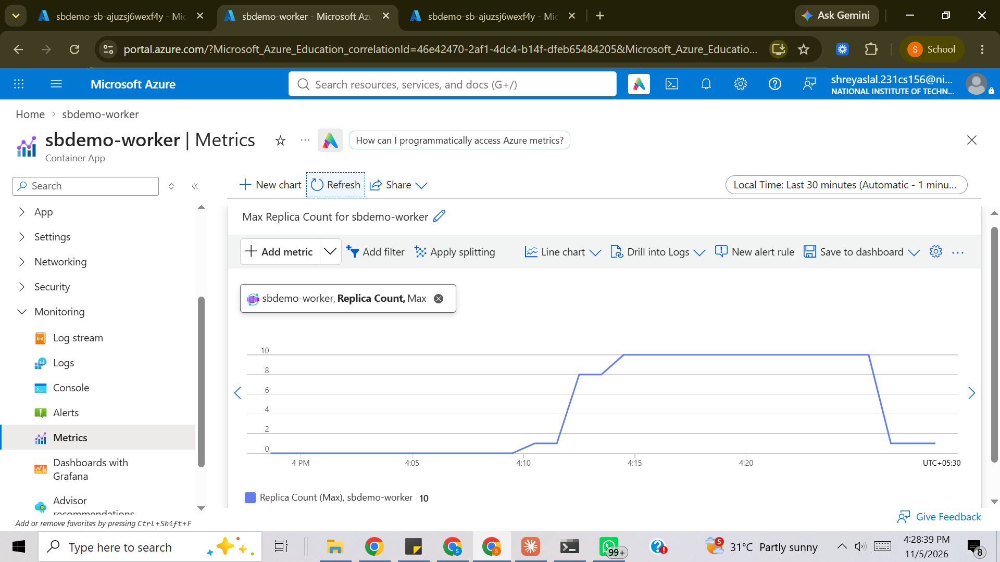

# Service Bus Pipeline

A C# worker that publishes to and consumes from an Azure Service Bus queue, deployed to Azure Container Apps with Bicep, a GitHub Actions pipeline, and queue-depth autoscaling (KEDA).

```
POST /publish ──► Service Bus queue "orders" ──► Consumer (async processor, 16 concurrent)
                         │                          ├─ success        → Complete
                         │                          ├─ transient fail → Abandon → redelivered
                         ▼                          └─ poison / 5th failure → Dead-letter queue
                  KEDA scales replicas 1..10 on active message count
```

## What it demonstrates

| Area | Implementation |
| --- | --- |
| Async consumer | `ServiceBusProcessor`, manual settlement, 16 concurrent calls per replica |
| Retries | SDK exponential retry for transport errors; abandon-and-redeliver for handler failures |
| Dead-lettering | Malformed or invalid messages dead-lettered at once; handler failures dead-lettered after `maxDeliveryCount = 5` |
| Infrastructure as code | `infra/main.bicep`: namespace, queue, Log Analytics, Container Apps environment (`environmentMode: WorkloadProfiles`, because Express does not support KEDA rules), app |
| Pipeline | build, test, container image to GHCR, optional Azure deploy + `/health` check (`.github/workflows/ci-cd.yml`) |
| Autoscaling | KEDA `azure-servicebus` rule, target 20 messages per replica, 1..10 replicas |
| Tests | `dotnet test`: 8 tests on the retry and dead-letter decision logic |

## Run the tests

```bash
dotnet test
```

## Deploy

1. Push this folder to GitHub. The `ci-cd` workflow runs the tests and publishes the image to `ghcr.io/<owner>/servicebus-worker:<sha>`. Make that package public (GitHub profile, Packages, servicebus-worker, Package settings, Change visibility).
2. Deploy from any shell with the Azure CLI:

```bash
az group create -n rg-sbpipeline -l <allowed-region>
az deployment group create -g rg-sbpipeline -f infra/main.bicep \
  -p prefix=sbdemo location=<allowed-region> image=ghcr.io/<owner>/servicebus-worker:<sha>
```

3. Optional: to let the workflow deploy itself, create an Entra app with a GitHub OIDC credential, set secrets `AZURE_CLIENT_ID`, `AZURE_TENANT_ID`, `AZURE_SUBSCRIPTION_ID`, variables `PREFIX`, `RESOURCE_GROUP`, `LOCATION`, `AZURE_DEPLOY=true`, and an environment named `azure`.

## Measure it

```bash
scripts/measure.sh <resource-group> <prefix> 5000
```

Then open Azure Portal, the Container App, **Metrics**, add `Replica Count`. In a second chart on the Service Bus namespace add `Active Messages`. Set the time range to the test window and screenshot both.

## Results

Measured on Azure Container Apps (East Asia), Service Bus Standard, 200 ms simulated processing per message, 16 concurrent calls per replica.

| Metric | Value |
| --- | --- |
| Messages | 20,000 |
| Baseline replicas | 1 |
| Peak replicas | 10 (KEDA, target 20 messages per replica) |
| Drain time | about 38 s |
| Throughput | about 500 msg/s (script reported 526) |

Replicas went 1 to 10 during the burst and back to 1 after the queue drained. The portal plots the pre-test period as 0 because it has no data there; the baseline was 1 replica (min replicas = 1). Throughput and timing are approximate: Azure Monitor samples at 1-minute granularity.



## Design notes and trade-offs

- The app and the KEDA rule use a queue-scoped shared access key, held as a Container Apps secret. A managed identity would remove the key; the app already supports it (`SERVICEBUS_FQDN` with `DefaultAzureCredential`).
- Processing is simulated with `PROCESSING_DELAY_MS` (default 200 ms) so a backlog builds and autoscaling is observable. Send `?failRate=0.05` to `/publish` to see messages reach the dead-letter queue.
- `/metrics` counters are per replica and in memory. Use Service Bus metrics for fleet-wide numbers.
- Delivery is at least once. Handlers must be idempotent.

## Clean up

```bash
az group delete -n <resource-group> --yes
```
